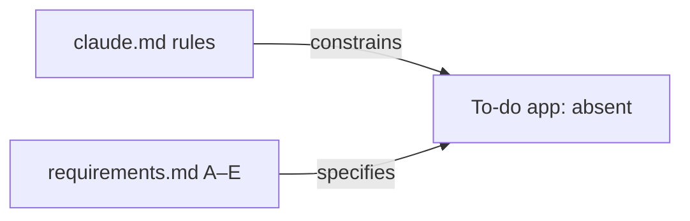
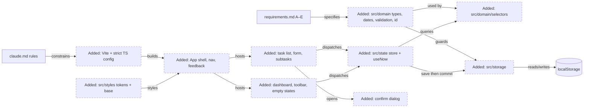
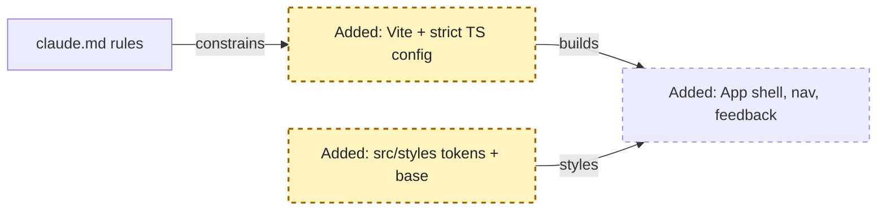
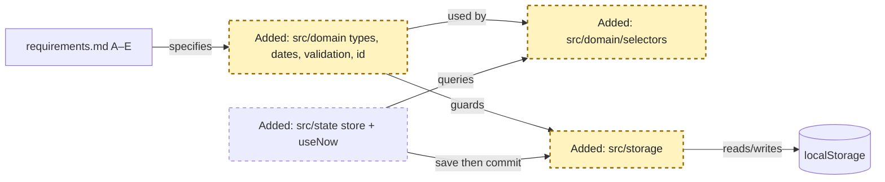
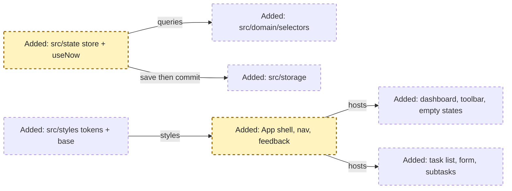
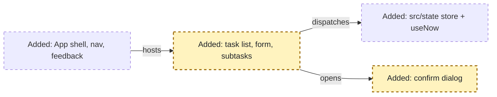
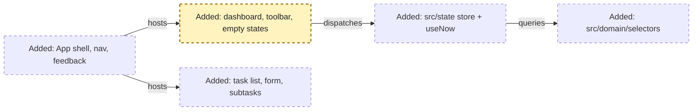
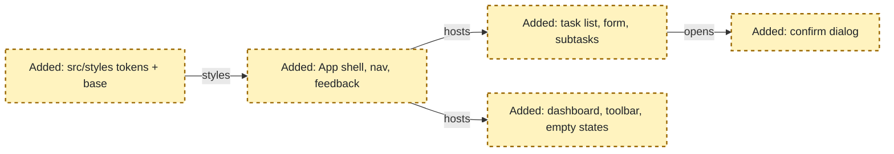

<!-- markdownlint-disable-file -->
# RPI Plan: To-do web app (requirements A–D)

## Task Metadata

* Task ID: todo-app
* Task slug: todo-app
* Plan date: 2026-10-19
* Step details: [.copilot-tracking/details/2026-10-19/todo-app-details.md](../../details/2026-10-19/todo-app-details.md), one section per `Pxx-Txx` (user-requested companion to this plan)

## Executive Summary

* Bottom line: This plan builds the full personal to-do app from an empty repository in six phases. The phases are: a Vite + React + strict TypeScript scaffold; a pure, timezone-safe domain and storage core; a store that saves first and commits after; task management (create, edit, complete, delete, priority, deadline, category, subtasks); the five views with dashboard, search, filter and sort; and a final pass on responsiveness, accessibility and manual verification. It adds no runtime dependencies beyond `react` and `react-dom`.
* Why this matters: Requirements D4–D6 (overdue logic, one timezone strategy) and D10–D13 (corrupt storage, no duplicates, UI consistent with persisted data) are where a naive build fails quietly. This plan designs them up front in pure modules, which later phases consume.
* Planning result: **Complete and Ready.** All decisions D-01 to D-07 are confirmed by the user. The standard critique returned Revise with four findings (two Medium, two Low: the category-filter contract, corrupt-data result shape, a category length cap, one dependency). All four are fixed in this revision (see [Critique Disposition](#critique-disposition)).
* Confidence and uncertainty: High. The stack, the platform APIs and the date pitfalls are backed by primary sources in the research. The remaining uncertainty is small UX judgment, recorded as Details assumptions and low-priority risks.

### What You May Not Know

* **The requirements file is not at `docs/requirements.md`.** It lives at [.claude/commands/docs/requirements.md](../../../.claude/commands/docs/requirements.md), and the rules file is [claude.md](../../../claude.md) (lowercase). The plan cites the real paths. Fixing the stale pointer in `claude.md` is a follow-up item.
* **`new Date("2026-10-19")` is UTC midnight.** All date handling goes through one module that builds dates from local parts, so deadlines never shift by a day west of UTC.
* **Deadlines are stored as a UTC ISO instant plus `hasDueTime` (D-04).** A date-only deadline is stored as 23:59 local on the day it was entered. If you later open the app in a different timezone, the date it shows can move. This is accepted residual risk.
* **The repository root is not empty**, so `npm create vite` has to be told to scaffold alongside the existing files, and must not overwrite `.gitignore` or `claude.md`.
* **There are no automated tests by project rule.** Validation evidence is `npm run build` and `npm run lint` passing, plus the manual checklist in P06-T03, recorded in the changes log.
* `crypto.randomUUID()` throws over plain-HTTP LAN (for example, phone testing with `vite --host`), so ID generation needs a fallback.

## Phase Checklist

### Before



The repository holds only HVE tooling, `claude.md` and the requirements. There's no `package.json`, `src/` or app.

### After



The app is built in layers. Pure domain modules (types, dates, validation, selectors) feed both the storage guards and the UI. The store is the only writer: it saves to `src/storage` first and commits React state only after the save succeeds. UI components read derived data through the selectors and dispatch through the store.

<!-- rpi:phase id=P01 -->
### [x] P01: Scaffold the project and design foundation

Goals:
* A buildable, lint-clean Vite + React + strict TypeScript project exists at the repository root, with a token-based CSS foundation every later component uses. Doing this first makes the strict-mode and styling rules checkable from the first line of app code.

Dependencies:
* None



Highlighted work: the scaffold and the style tokens. Shell is shown as the later consumer only.

<!-- rpi:task id=P01-T01 -->
#### [x] P01-T01: Scaffold Vite react-ts with explicit strict TypeScript

Goals:
* `npm run dev`, `npm run build` and `npm run lint` work at the repository root and render a placeholder app with no template demo content.

Requirements:
* NFR-001, NFR-002
* `tsconfig.app.json` states `"strict": true` and `"noUncheckedIndexedAccess": true` explicitly.
* `package.json` `dependencies` contains only `react` and `react-dom`. Versions are pinned as emitted by `create-vite` at implementation time.
* Existing `.gitignore` entries, `claude.md`, `.claude/` and `.hve-core/` are preserved. `node_modules` and `dist` are ignored.

Details:
* Greenfield. Scaffold the official `react-ts` template into the non-empty root without losing existing files. Remove the demo assets, the counter and the template CSS. Keep the template's oxlint setup and `<StrictMode>`. Set the document `<title>` and `lang="en"`. Step-level guidance: [details P01-T01](../../details/2026-10-19/todo-app-details.md#p01-t01-scaffold-vite-react-ts-with-explicit-strict-typescript).

References:
* [claude.md](../../../claude.md): stack rule
* [.copilot-tracking/research/2026-10-19/todo-app-research.md](../../research/2026-10-19/todo-app-research.md):
  * "The mandated stack is current…" and "Strict TypeScript is the default, but should be stated explicitly" under `## Findings` (C5, W1–W3)

Dependencies:
* None

<!-- rpi:task id=P01-T02 -->
#### [x] P01-T02: Establish CSS tokens and base styles

Goals:
* Colors, spacing, radius, typography, shadows and the focus ring are defined once as CSS custom properties and applied by a base stylesheet. That stylesheet includes a visible `:focus-visible` style, a `.visually-hidden` utility and skip-link styling.

Requirements:
* NFR-003, NFR-007
* Light theme only (D-03). Every color used by components is a token in `src/styles/tokens.css`.
* Priority colors exist as tokens for all four levels, and text-on-fill pairs meet WCAG 2.2 AA contrast (4.5:1 for text).

Details:
* Plain CSS, no preprocessor. Components may use co-located `.css` files that reference tokens only. Token list and naming: [details P01-T02](../../details/2026-10-19/todo-app-details.md#p01-t02-establish-css-tokens-and-base-styles).

References:
* [.copilot-tracking/research/2026-10-19/todo-app-research.md](../../research/2026-10-19/todo-app-research.md):
  * C1, C8 and C9 rows of the "Requirement coverage map" under `## Findings`; D-03 under `## Decisions and Feedback`

Dependencies:
* P01-T01

<!-- rpi:phase id=P02 -->
### [x] P02: Build the domain and storage core

Goals:
* Every business rule that can be pure is a pure TypeScript function: types, timezone-safe dates, validation, IDs, view and query selectors, and a defensive storage module. UI phases consume these instead of re-deriving rules, which is how D4–D6 and D9–D12 stay correct and consistent.

Dependencies:
* P01



Highlighted work: domain modules, selectors and storage. The store is shown as the next consumer.

<!-- rpi:task id=P02-T01 -->
#### [x] P02-T01: Define the domain types

Goals:
* One module exports the task, subtask, priority, view, filter and sort types every other module uses.

Requirements:
* FR-005, FR-006, FR-007, FR-008, FR-010, FR-011, FR-012
* Contract (binding shape; field order and comments are illustrative):

```ts
export type Priority = 'low' | 'medium' | 'high' | 'urgent';
export interface Subtask { id: string; title: string; completed: boolean }
export interface Task {
  id: string;
  title: string;              // trimmed, 1–200 chars
  description: string;        // '' when absent, ≤ 2000 chars
  priority: Priority;
  dueAt: string | null;       // ISO 8601 UTC instant (toISOString()), null = no deadline
  hasDueTime: boolean;        // false => dueAt is 23:59 local of the chosen date
  category: string;           // trimmed, '' when absent
  completed: boolean;
  completedAt: string | null; // ISO 8601
  subtasks: Subtask[];
  createdAt: string;          // ISO 8601
  updatedAt: string;          // ISO 8601
}
export type ViewId = 'my-day' | 'upcoming' | 'overdue' | 'completed' | 'all';
export type StatusFilter = 'all' | 'active' | 'completed';
export type DueFilter = 'any' | 'overdue' | 'today' | 'upcoming' | 'none';
export type SortKey = 'created' | 'priority' | 'deadline';
export interface TaskQuery {
  search: string;
  status: StatusFilter;
  priority: Priority | 'all';
  category: string | null;    // null = all categories, '' = uncategorized
  due: DueFilter;
  sort: SortKey;
}
```

Details:
* Keep `dueAt` and `hasDueTime` consistent: `hasDueTime` is always `false` when `dueAt` is `null`. See [details P02-T01](../../details/2026-10-19/todo-app-details.md#p02-t01-define-the-domain-types).

References:
* [.copilot-tracking/research/2026-10-19/todo-app-research.md](../../research/2026-10-19/todo-app-research.md):
  * "Date and time handling needs an explicit model…" under `## Findings`; D-04 under `## Decisions and Feedback`

Dependencies:
* P01-T01

<!-- rpi:task id=P02-T02 -->
#### [x] P02-T02: Implement timezone-safe date utilities

Goals:
* One module converts form input to stored deadlines and back, defines the local "today" window, classifies a task as overdue, due today or upcoming relative to a supplied `now`, and formats deadline labels.

Requirements:
* FR-006, FR-012, FR-016, NFR-006
* Date-only input becomes 23:59:00.000 local on that date. Date + time becomes that local minute. Both are stored with `toISOString()`.
* No code path calls `new Date('YYYY-MM-DD')` or `Date.parse` on a date-only string. Local dates are built from numeric parts.
* `isOverdue(task, now)` is `!task.completed && task.dueAt !== null && Date.parse(task.dueAt) < now.getTime()`. A task without a deadline is never overdue, due today or upcoming.
* `isDueToday` uses the local calendar day of `now`. `isUpcoming` means the due instant is on or after local midnight tomorrow (D-01).
* Every function that depends on the current time takes `now: Date` as a parameter. None reads the clock internally.
* The module's top-of-file TSDoc states the timezone strategy from `claude.md`, which satisfies D6's "documented" requirement in code.

Details:
* Function list, round-trip rules and label formats: [details P02-T02](../../details/2026-10-19/todo-app-details.md#p02-t02-implement-timezone-safe-date-utilities).

References:
* [claude.md](../../../claude.md): timezone strategy
* [.copilot-tracking/research/2026-10-19/todo-app-research.md](../../research/2026-10-19/todo-app-research.md):
  * "Date and time handling needs an explicit model…" under `## Findings` (W4); D-01 under `## Decisions and Feedback`

Dependencies:
* P02-T01

<!-- rpi:task id=P02-T03 -->
#### [x] P02-T03: Implement validation and ID generation

Goals:
* Shared validators return field-level error messages for task and subtask input, and an ID generator produces unique IDs in both secure and non-secure contexts.

Requirements:
* FR-001, FR-008, FR-021, FR-022
* Limits from `claude.md` live in exported constants: title 1–200 characters after trim and not whitespace-only, description ≤ 2000, subtask title 1–200 after trim.
* `LIMITS` also fixes `categoryMax: 50`. `claude.md` sets no category limit, so this is a planner choice. The validator and the storage guards share the constant, and the guards truncate an over-long stored category instead of dropping the task.
* `createId()` uses `crypto.randomUUID` when available and otherwise falls back to `crypto.getRandomValues`. It never throws on plain-HTTP origins.

Details:
* Validators return `{ field: message }` maps for inline display. See [details P02-T03](../../details/2026-10-19/todo-app-details.md#p02-t03-implement-validation-and-id-generation).

References:
* [claude.md](../../../claude.md): limits
* [.copilot-tracking/research/2026-10-19/todo-app-research.md](../../research/2026-10-19/todo-app-research.md):
  * "ID generation must not break mobile-device testing" under `## Findings` (W7)

Dependencies:
* P02-T01

<!-- rpi:task id=P02-T04 -->
#### [x] P02-T04: Implement the defensive storage module

Goals:
* `src/storage` loads and saves the task list without ever throwing to callers. It recovers valid records from partially corrupt data, preserves unreadable raw data in a backup key, and reports write failures.

Requirements:
* FR-018, FR-019, FR-020, NFR-005
* Contract (binding):

```ts
export type LoadResult =
  | { status: 'ok'; tasks: Task[] }
  | { status: 'empty'; tasks: [] }
  | { status: 'recovered'; tasks: Task[]; droppedCount: number | null; repairedCount: number; backupKey: string | null } // droppedCount null = payload unreadable
  | { status: 'unavailable'; tasks: []; error: string };
export type SaveResult = { ok: true } | { ok: false; error: string };
export function loadTasks(): LoadResult;
export function saveTasks(tasks: Task[]): SaveResult;
```

* Stored value is the envelope `{ "version": 1, "tasks": Task[] }` under one namespaced key.
* Each record passes a hand-written runtime guard. Repairable inconsistencies are repaired. Invalid records are dropped, and records with duplicate IDs keep only the first occurrence.
* When anything is dropped or repaired, or the payload is unreadable, the load returns `recovered`. During load, the original raw string is copied to a timestamped backup key on a best-effort basis (`backupKey: null` when that write fails).
* `SecurityError`, `QuotaExceededError` and any other exception are caught and returned as results.

Details:
* Guard rules, the backup-key format and what counts as recovered: [details P02-T04](../../details/2026-10-19/todo-app-details.md#p02-t04-implement-the-defensive-storage-module).

References:
* [.copilot-tracking/research/2026-10-19/todo-app-research.md](../../research/2026-10-19/todo-app-research.md):
  * "localStorage needs a defensive storage module" under `## Findings` (W5)

Dependencies:
* P02-T01, P02-T03

<!-- rpi:task id=P02-T05 -->
#### [x] P02-T05: Implement view and query selectors

Goals:
* Pure selectors decide view membership, view counts, search, filters, sort, daily progress and subtask progress, and one composed function applies view → search → filters → sort in a fixed order.

Requirements:
* FR-008, FR-009, FR-010, FR-011, FR-012, FR-013, FR-015
* View membership follows D-01. `my-day`: due today (any completion state). `upcoming`: due on or after local midnight tomorrow (any completion state). `overdue`: `isOverdue`. `completed`: `completed === true`. `all`: every task.
* `viewCounts(tasks, now)` uses the same predicates as `selectView`, so badges always match lists.
* Search is a case-insensitive substring match on title and description, ignoring leading and trailing whitespace in the query.
* Sorting is stable and deterministic. `created`: newest first. `priority`: urgent → low, then deadline ascending. `deadline`: ascending, with no-deadline tasks last. Ties fall back to `createdAt` descending, then `id`.
* `dailyProgress(tasks, now)` returns `{ done, total }` over tasks due today (D-02).
* `subtaskProgress(task)` returns `{ done, total }` from `task.subtasks`.

Details:
* Composition order and an edge-case table: [details P02-T05](../../details/2026-10-19/todo-app-details.md#p02-t05-implement-view-and-query-selectors).

References:
* [.copilot-tracking/research/2026-10-19/todo-app-research.md](../../research/2026-10-19/todo-app-research.md):
  * A9–A11, B1–B5, B7 and B10 rows of the "Requirement coverage map" under `## Findings`; D-01 and D-02 under `## Decisions and Feedback`

Dependencies:
* P02-T01, P02-T02

<!-- rpi:phase id=P03 -->
### [x] P03: Wire state, feedback and the navigable app shell

Goals:
* The app loads persisted tasks once, exposes a store that saves first and commits after, keeps time-dependent views current, announces feedback, and renders a responsive shell with view navigation and counts. Feature phases then plug into a working frame.

Dependencies:
* P02



Highlighted work: the store with `useNow`, and the shell with navigation and feedback.

<!-- rpi:task id=P03-T01 -->
#### [x] P03-T01: Build the task store with persist-then-commit

Goals:
* Components read `tasks` and call typed actions. Each action computes the next list, attempts `saveTasks`, and commits React state only when the save succeeds. Otherwise state is unchanged and an error is surfaced.

Requirements:
* FR-018, FR-020, FR-021, NFR-005
* Initial load runs exactly once, through a lazy state initializer. It never runs in a mount effect, and the app never writes during startup.
* Actions cover at least: create, update, toggle complete, delete, add, rename, toggle and delete a subtask.
* Updates and deletes address tasks by `id` (`map` or `filter`). Create appends exactly one task with a fresh ID.
* Each action returns whether it committed, so callers show success feedback only after a successful save.
* The load result status is exposed for P03-T02 notices.

Details:
* Keep transitions in a pure reducer-style function so they can be reasoned about separately from persistence. React 19 `<StrictMode>` double-invokes initializers and updaters in development, so don't call `saveTasks` inside a state updater function. See [details P03-T01](../../details/2026-10-19/todo-app-details.md#p03-t01-build-the-task-store-with-persist-then-commit).

References:
* [.copilot-tracking/research/2026-10-19/todo-app-research.md](../../research/2026-10-19/todo-app-research.md):
  * "React 19 StrictMode affects how initialization should be written" and "localStorage needs a defensive storage module" under `## Findings`

Dependencies:
* P02-T04

<!-- rpi:task id=P03-T02 -->
#### [x] P03-T02: Add the clock hook, feedback toasts and storage notices

Goals:
* Time-dependent UI re-evaluates every minute and when the tab becomes visible. User actions produce an announced status message. Storage outcomes (recovered, unavailable, save failed) are explained in a dismissible, non-blocking notice.

Requirements:
* FR-022, FR-023, FR-025, NFR-003
* `useNow()` returns a `Date` that updates on a 60-second interval and on `visibilitychange` to visible, and cleans up both listeners.
* Toasts render in a persistent `aria-live="polite"` region that exists in the DOM before any message is inserted. Errors use `role="alert"`.
* A `recovered` load tells the user how many records were dropped and that a backup was kept. An `unavailable` load says changes cannot be saved, and the app still renders.

Details:
* Message copy and timing: [details P03-T02](../../details/2026-10-19/todo-app-details.md#p03-t02-add-the-clock-hook-feedback-toasts-and-storage-notices). C6 initialization: localStorage reads are synchronous, so a spinner would be fake. The initialization state required "where appropriate" is satisfied by the storage notices plus a first-run empty state (supported assumption).

References:
* [.copilot-tracking/research/2026-10-19/todo-app-research.md](../../research/2026-10-19/todo-app-research.md):
  * "Views go stale at midnight…" row under `## Risks and Open Questions`; C5 and C6 rows of the "Requirement coverage map"

Dependencies:
* P03-T01

<!-- rpi:task id=P03-T03 -->
#### [x] P03-T03: Build the responsive shell and view navigation

Goals:
* A layout shows a sidebar on wide screens and a bottom navigation bar on narrow screens. It lists the five views with live counts, marks the current view, and offers a skip link to the main content.

Requirements:
* FR-012, FR-013, FR-024, NFR-003, NFR-004
* The breakpoint is 768px: sidebar at 768px and wider, bottom navigation below.
* Navigation items are buttons or links with visible text labels, `aria-current="page"` on the active view, and a count badge with an accessible name, for example "Overdue, 3 tasks".
* The active view lives in React state with `my-day` as the default. No router dependency.
* The main region has a heading naming the current view.

Details:
* Landmark structure and the layout grid: [details P03-T03](../../details/2026-10-19/todo-app-details.md#p03-t03-build-the-responsive-shell-and-view-navigation).

References:
* [.copilot-tracking/research/2026-10-19/todo-app-research.md](../../research/2026-10-19/todo-app-research.md):
  * C2, C3, C4 and B10 rows of the "Requirement coverage map" under `## Findings`

Dependencies:
* P01-T02, P02-T05, P03-T01

<!-- rpi:phase id=P04 -->
### [x] P04: Deliver task management

Goals:
* Users can create, view, edit, complete, reopen and delete tasks with priority, deadline, category and subtasks. Validation, confirmation and feedback behave as the rules require. This covers all of section A except search, filter and sort.

Dependencies:
* P03



Highlighted work: the task list, form and subtask editor, plus the confirm dialog.

<!-- rpi:task id=P04-T01 -->
#### [x] P04-T01: Render task items with status, priority, deadline and progress

Goals:
* Each task row shows a labeled completion checkbox, the title, a priority badge, a deadline label (visibly flagged when overdue), a category chip and subtask progress. It has edit and delete actions, and an expandable checklist toggles subtasks directly. Completed tasks are clearly distinct.

Requirements:
* FR-003, FR-005, FR-008, FR-016, NFR-003
* Priority and overdue state are conveyed by text as well as color, for example "Urgent" and "Overdue · 2 h".
* Completed styling uses more than color alone, for example strikethrough plus muted tone.
* Toggling completion sets or clears `completedAt` through the store and announces "Task completed" or "Task reopened".
* Subtask progress reads "2 of 5 subtasks". Toggling a subtask in the row persists immediately through the store.
* The task list is a semantic list (`ul`/`li`). Interactive controls have accessible names that include the task title.

Details:
* See [details P04-T01](../../details/2026-10-19/todo-app-details.md#p04-t01-render-task-items-with-status-priority-deadline-and-progress).

References:
* [.copilot-tracking/research/2026-10-19/todo-app-research.md](../../research/2026-10-19/todo-app-research.md):
  * A3, A5, A6, A8 and B8 rows of the "Requirement coverage map" under `## Findings`

Dependencies:
* P02-T02, P02-T05, P03-T01, P03-T02, P03-T03

<!-- rpi:task id=P04-T02 -->
#### [x] P04-T02: Build the create and edit task form

Goals:
* One form, opened as a modal `<dialog>`, creates a new task or edits an existing one. It has title, description with a character counter, priority, an optional date and time, a category with suggestions, and a subtask editor. Inline validation and a single, non-duplicating submit complete it.

Requirements:
* FR-001, FR-002, FR-005, FR-006, FR-007, FR-021, FR-022, NFR-003
* Every control has a `<label>`. Errors are linked with `aria-describedby`, and focus moves to the first invalid field on a failed submit.
* The time input is usable only when a date is set. Clearing the date clears the time. Editing a task round-trips its deadline exactly through `hasDueTime` (D-04).
* Category is a free-text input with a `<datalist>` of distinct existing categories (D-05). The value is trimmed.
* New tasks default to priority `medium`.
* Submit is disabled while a save is in flight, and the dialog closes only after a successful commit. Edit updates by `id` and never creates a second task.
* Esc and Cancel close without saving, and focus returns to the control that opened the form.

Details:
* Field-by-field behavior: [details P04-T02](../../details/2026-10-19/todo-app-details.md#p04-t02-build-the-create-and-edit-task-form).

References:
* [claude.md](../../../claude.md): limits and timezone strategy
* [.copilot-tracking/research/2026-10-19/todo-app-research.md](../../research/2026-10-19/todo-app-research.md):
  * "Native `<dialog>` covers the confirmation and accessibility requirements cheaply" under `## Findings` (W6); D-04 and D-05 under `## Decisions and Feedback`

Dependencies:
* P02-T02, P02-T03, P03-T01, P03-T02

<!-- rpi:task id=P04-T03 -->
#### [x] P04-T03: Build the subtask editor inside the form

Goals:
* In the task form, users can add, rename, toggle and delete subtasks inline (D-06). The changes save with the task.

Requirements:
* FR-008, FR-022, NFR-003
* Subtask titles are validated 1–200 characters after trim, with an inline message. An empty new-subtask input adds nothing.
* Pressing Enter in the new-subtask input adds the subtask and does not submit the whole form.
* Each subtask row has a labeled checkbox, an editable title and a delete button named after the subtask.
* No due dates or priorities on subtasks.

Details:
* Subtasks are held in the form draft until Save. Row toggles from P04-T01 remain the immediate path. See [details P04-T03](../../details/2026-10-19/todo-app-details.md#p04-t03-build-the-subtask-editor-inside-the-form).

References:
* [.copilot-tracking/research/2026-10-19/todo-app-research.md](../../research/2026-10-19/todo-app-research.md):
  * D-06 under `## Decisions and Feedback`

Dependencies:
* P04-T02

<!-- rpi:task id=P04-T04 -->
#### [x] P04-T04: Add delete confirmation

Goals:
* Deleting a task always goes through a modal confirmation that names the task. Confirming removes only that task, and focus lands somewhere sensible afterwards.

Requirements:
* FR-004, FR-022, NFR-003
* A reusable confirm dialog built on native `<dialog>` with `showModal()`. Cancel has `autofocus`, and Esc cancels.
* The confirm button text is specific ("Delete task"). The dialog text includes the task title.
* Delete filters by `id`. After a successful delete, the app announces "Task deleted" and moves focus to the list heading or the next task. On cancel, focus returns to the delete button.

Details:
* See [details P04-T04](../../details/2026-10-19/todo-app-details.md#p04-t04-add-delete-confirmation).

References:
* [.copilot-tracking/research/2026-10-19/todo-app-research.md](../../research/2026-10-19/todo-app-research.md):
  * "Native `<dialog>` covers…" under `## Findings` (W6)

Dependencies:
* P04-T01

<!-- rpi:phase id=P05 -->
### [x] P05: Deliver views, dashboard, search, filter and sort

Goals:
* Each view shows the right tasks, with a quick-add field, the daily progress indicator, a search/filter/sort toolbar that composes correctly, and helpful empty states. This completes section B and requirements A9–A11.

Dependencies:
* P04



Highlighted work: the dashboard, toolbar and empty states.

<!-- rpi:task id=P05-T01 -->
#### [x] P05-T01: Add quick-add and the daily progress indicator

Goals:
* Above the list, a single-field quick-add creates a task on Enter. A progress indicator shows "N of M done today" for tasks due today.

Requirements:
* FR-014, FR-015, FR-021, FR-022, NFR-003
* Quick-add validates the title with the shared validator, shows an inline error, ignores repeat submits while saving, and clears only after a successful commit.
* A quick-added task gets priority `medium`. When the active view is My Day, it is due today with no time (23:59 local), so it stays visible. In every other view it has no deadline. The confirmation toast names where the task went.
* Progress uses `dailyProgress` with an accessible `<progress>` (or `role="progressbar"` with value attributes) plus visible text. When nothing is due today, it shows a short empty message instead of "0 of 0".

Details:
* The My Day due-today default is a supported assumption that keeps B1 and B6 coherent. The implementer may resolve its copy locally. See [details P05-T01](../../details/2026-10-19/todo-app-details.md#p05-t01-add-quick-add-and-the-daily-progress-indicator).

References:
* [.copilot-tracking/research/2026-10-19/todo-app-research.md](../../research/2026-10-19/todo-app-research.md):
  * B6 and B7 rows of the "Requirement coverage map"; D-02 under `## Decisions and Feedback`

Dependencies:
* P04-T01

<!-- rpi:task id=P05-T02 -->
#### [x] P05-T02: Add the search, filter and sort toolbar

Goals:
* A toolbar offers search, status, priority, category and due filters, plus a sort selector. The visible list is always `queryTasks(tasks, view, query, now)`, so every combination composes correctly.

Requirements:
* FR-009, FR-010, FR-011, NFR-003
* Each control is labeled. Changing a control updates the list immediately with no submit step.
* The category filter lists distinct existing categories plus "Uncategorized" when any task lacks one.
* A "Clear filters" action resets search and filters to defaults. Sort is kept.
* Query state persists across view changes during the session. It isn't saved to localStorage.
* On narrow screens the filters can collapse behind a toggle button that has `aria-expanded`.

Details:
* Default query: `search ''`, `status 'all'`, `priority 'all'`, `category 'all'`, `due 'any'`, `sort 'created'`. See [details P05-T02](../../details/2026-10-19/todo-app-details.md#p05-t02-add-the-search-filter-and-sort-toolbar).

References:
* [.copilot-tracking/research/2026-10-19/todo-app-research.md](../../research/2026-10-19/todo-app-research.md):
  * A9–A11 and D9 rows of the "Requirement coverage map" under `## Findings`

Dependencies:
* P02-T05, P04-T01

<!-- rpi:task id=P05-T03 -->
#### [x] P05-T03: Add view-specific and no-results empty states

Goals:
* An empty view explains itself and offers a next step. When filters hide everything, a distinct message offers to clear them.

Requirements:
* FR-017
* Each of the five views has its own empty-state copy. The "no results" state appears only when the view has tasks but the query hides all of them.
* Empty states with a call to action focus or open the relevant control (quick-add or clear filters).

Details:
* Copy suggestions: [details P05-T03](../../details/2026-10-19/todo-app-details.md#p05-t03-add-view-specific-and-no-results-empty-states).

References:
* [.copilot-tracking/research/2026-10-19/todo-app-research.md](../../research/2026-10-19/todo-app-research.md):
  * B9 row of the "Requirement coverage map" under `## Findings`

Dependencies:
* P05-T01, P05-T02

<!-- rpi:phase id=P06 -->
### [x] P06: Polish responsiveness and accessibility, then verify manually

Goals:
* The app is comfortable on mobile, tablet and desktop, is fully keyboard-operable with visible focus, is visually consistent, and has documented manual evidence for every requirement. Under the no-tests rule, this phase is the validation gate.

Dependencies:
* P05



Highlighted work: refinements across all UI nodes and tokens. No new modules.

<!-- rpi:task id=P06-T01 -->
#### [x] P06-T01: Tune responsive layout across breakpoints

Goals:
* Layouts work from 360px to 1440px wide without horizontal scrolling. Touch targets are comfortable, and dialogs fit small screens.

Requirements:
* FR-024, NFR-004
* Interactive targets are at least 44×44 CSS px on narrow screens.
* Dialogs are usable at 360px with no content clipped. The bottom navigation does not cover the last list item.

Details:
* See [details P06-T01](../../details/2026-10-19/todo-app-details.md#p06-t01-tune-responsive-layout-across-breakpoints).

References:
* [.claude/commands/docs/requirements.md](../../../.claude/commands/docs/requirements.md): section C

Dependencies:
* P05-T03

<!-- rpi:task id=P06-T02 -->
#### [x] P06-T02: Run the accessibility and consistency pass

Goals:
* The whole app can be operated by keyboard alone, with visible focus. Labels and live announcements are correct, and styling uses tokens consistently.

Requirements:
* NFR-003, NFR-007
* Tab order follows the visual order. The skip link works, and no focus trap exists outside open dialogs.
* No hard-coded color values outside `src/styles/tokens.css`.

Details:
* Checklist: [details P06-T02](../../details/2026-10-19/todo-app-details.md#p06-t02-run-the-accessibility-and-consistency-pass).

References:
* [.copilot-tracking/research/2026-10-19/todo-app-research.md](../../research/2026-10-19/todo-app-research.md):
  * "A11y checks against WCAG 2.2 AA" row under `## Risks and Open Questions`

Dependencies:
* P06-T01

<!-- rpi:task id=P06-T03 -->
#### [x] P06-T03: Verify every requirement manually and record evidence

Goals:
* `npm run build` and `npm run lint` pass, and a manual browser checklist covering every `FR-nnn` and `NFR-nnn`, with the date, storage and duplicate edge cases, is executed. Its results are recorded in the changes record.

Requirements:
* All FR-001 to FR-025 and NFR-001 to NFR-007.
* The checklist includes at least these cases:
  * a date-only deadline in a timezone west of UTC (DevTools Sensors timezone override)
  * overdue switching while the tab stays open
  * corrupt and partially invalid stored JSON
  * storage unavailable or save failure
  * rapid double submit
  * delete isolation
  * reload persistence
  * ID generation over a LAN IP
* Results, including any failures, are recorded in `.copilot-tracking/changes/2026-10-19/todo-app-changes.md`.

Details:
* Full checklist with steps: [details P06-T03](../../details/2026-10-19/todo-app-details.md#p06-t03-verify-every-requirement-manually-and-record-evidence). No automated tests are added (`claude.md`).

References:
* [claude.md](../../../claude.md): manual verification rule

Dependencies:
* P06-T02

## User Decisions and Requirements

### Confirmed User Direction

* Build the personal, single-user to-do web app in requirements sections A–D ([.claude/commands/docs/requirements.md](../../../.claude/commands/docs/requirements.md)) under [claude.md](../../../claude.md). AI features are out of scope.
* Stack: React + TypeScript (strict) + Vite, plain CSS with CSS variables, React state and hooks only, localStorage behind `src/storage`.
* No automated tests. Verify manually in the browser.
* Timezone strategy, length limits and the HVE workflow are fixed by `claude.md`.
* D-01: My Day = all tasks due today (completed and already-late included). Overdue = incomplete and past deadline (may overlap My Day). Upcoming = due tomorrow or later.
* D-02: Daily progress = completed ÷ total among tasks due today. Zero due today shows an empty state.
* D-03: Light theme only this round. Colors live in CSS variables.
* D-04: Store deadlines as an ISO 8601 UTC `dueAt` plus `hasDueTime: boolean` (user answer, 2026-10-19 planning walkthrough).
* D-05: Category is free text with suggestions from existing categories. No management screen (user answer).
* D-06: Subtasks support add, rename, toggle and delete inline. No due dates or priorities (user answer).
* D-07: No runtime dependencies beyond `react` and `react-dom` (user answer).
* Save the plan under `.copilot-tracking/plans/` and step details under `.copilot-tracking/details/`. Write no app code during planning (`/task-plan` prompt). This plan's companion details file is the user-requested exception to rpi-plan's single-artifact default.

### Planning Decisions and Feedback

| Group | Decision or feedback item | Status | Owner | Rationale or input needed | Evidence | Planning impact |
|-------|---------------------------|--------|-------|---------------------------|----------|-----------------|
| D-04 | Deadline storage model | confirmed | user | ISO `dueAt` + `hasDueTime` chosen | research D-04; walkthrough answer | P02-T01, P02-T02, P04-T02 |
| D-05 | Category model | confirmed | user | Free text + datalist chosen | research D-05; walkthrough answer | P04-T02, P05-T02 |
| D-06 | Subtask capability | confirmed | user | Add, rename, toggle, delete chosen | research D-06; walkthrough answer | P04-T01, P04-T03 |
| D-07 | Runtime dependencies | confirmed | user | None beyond react/react-dom | research D-07; walkthrough answer | P01-T01, NFR-002 |
| D-08 | Quick-add deadline default in My Day | confirmed | agent (planner assumption, implementer may adjust copy) | Without it, a task quick-added from My Day would vanish from the current view; B1 + B6 coherence | requirements B1, B6 | P05-T01 |

No unresolved material decisions remain. The walkthrough is complete.

## Planning Readiness and Next Step

| Field | Record |
|-------|--------|
| Planning execution and readiness | Complete; Ready |
| Decision participation | user-owned (standalone `/task-plan` invocation); D-04 to D-07 answered by the user |
| Blockers | none |
| Latest critique | [.copilot-tracking/reviews/plans/2026-10-19/todo-app-plan-critique.md](../../reviews/plans/2026-10-19/todo-app-plan-critique.md) with Revise (2 Medium, 2 Low); all four resolved by direct correction in this revision |
| Relevant research | [.copilot-tracking/research/2026-10-19/todo-app-research.md](../../research/2026-10-19/todo-app-research.md) |
| Step details | [.copilot-tracking/details/2026-10-19/todo-app-details.md](../../details/2026-10-19/todo-app-details.md) |
| Plan | `.copilot-tracking/plans/2026-10-19/todo-app-plan.md` |
| Changes-record role | [.copilot-tracking/changes/2026-10-19/todo-app-changes.md](../../changes/2026-10-19/todo-app-changes.md) is implementation evidence |
| Continuation owner | user |
| Required gates or confirmations | Plan gates passed: decisions confirmed, critique disposed, self-check complete |
| Implementation | Complete for the full plan (2026-10-19); all markers checked; build, lint and the P06-T03 checklist pass. Review findings RV-001 (P03-T02) and RV-002 (P04-T01) implemented afterwards; build and lint pass |
| Next action | None required. Optional: hands-on browser check of the blocked-storage notice and subtask checkbox names |

## Goals

* A working, persistent, single-user to-do app that meets requirements A–D on the mandated stack.
* Correct and consistent date logic under the `claude.md` timezone strategy.
* Storage that survives corrupt data and failed writes without losing user data or misleading the UI.
* An accessible, responsive, consistent minimalist UI.

## Scope and Non-Goals

### In Scope

* Requirements sections A, B, C (except C9 dark theme) and D, plus the E stack.
* Project scaffold, CSS tokens, domain modules, storage, state, UI and the manual verification record.

### Non-Goals

* AI features (`docs/requirements-ai.md`).
* Dark theme (D-03). Tokens keep it possible later.
* Automated tests, a backend, sync, multi-user, accounts.
* URL routing, multi-tab live sync, import/export, a category management screen, subtask deadlines.

## Functional Requirements

* FR-001: Create a task with a required title (trimmed, 1–200 characters, not whitespace-only) and an optional description (≤ 2000 characters). (A1, D1, D2)
* FR-002: Edit any field of an existing task. (A2)
* FR-003: Mark a task complete and reopen it. Completed and incomplete tasks are visually distinct. (A3, D3)
* FR-004: Delete a task only after confirmation. Other tasks are unaffected. (A4, C7, D8)
* FR-005: Assign priority Low, Medium, High or Urgent. (A5)
* FR-006: Set an optional due date and an optional due time. A date without a time is due 23:59 local. Stored per D-04. (A6, claude.md)
* FR-007: Assign a free-text category with suggestions. (A7, D-05)
* FR-008: Add, rename, toggle and delete subtasks (title 1–200). The parent shows accurate subtask progress. (A8, D12, D-06)
* FR-009: Search tasks by title and description. (A9)
* FR-010: Filter by status, priority, category and due bucket. (A10)
* FR-011: Sort by creation date, priority or deadline. Search, filter, sort and view compose correctly. (A11, D9)
* FR-012: Provide My Day, Upcoming, Overdue, Completed and All Tasks views per D-01. Overdue tasks are incomplete with a deadline earlier than now. Tasks without deadlines are never overdue. (B1–B5, D4, D5)
* FR-013: Show task counts for each view, consistent with view contents. (B10)
* FR-014: Provide a quick-add field on the dashboard. (B6)
* FR-015: Show a daily progress indicator per D-02. (B7)
* FR-016: Show clear priority and deadline indicators, including overdue. (B8)
* FR-017: Show useful empty states, plus a distinct no-results state. (B9)
* FR-018: Persist tasks across refreshes in localStorage behind `src/storage`. (D, E)
* FR-019: Handle invalid or corrupt stored data gracefully: keep valid records, back up the raw data, inform the user. (D10)
* FR-020: Commit UI changes only after a successful save. On failure, keep the prior state and show an error. (D13)
* FR-021: Updates never create duplicate tasks. Double submits are ignored. (D11)
* FR-022: Show validation messages and clear feedback after actions. (C5)
* FR-023: Show initialization and storage-status notices where appropriate. (C6)
* FR-024: Sidebar navigation on desktop, bottom navigation on mobile. Supports desktop, tablet and mobile. (C2, C3)
* FR-025: Time-dependent views and counts update while the app stays open (minute tick and on tab focus). (D4 correctness over time)

## Non-Functional Requirements

* NFR-001: Strict TypeScript.
  * Objective threshold or evaluation condition: `tsconfig.app.json` has `"strict": true`; `npm run build` completes with zero type errors; `npm run lint` reports zero errors.
* NFR-002: Minimal dependencies.
  * Objective threshold or evaluation condition: `dependencies` contains only `react` and `react-dom`.
* NFR-003: Accessibility.
  * Objective threshold or evaluation condition: all functionality is keyboard-operable; every control has an accessible name; `:focus-visible` is visible on every interactive element; text contrast ≥ 4.5:1 (WCAG 2.2 AA).
  * Operating condition or verification approach, if needed: manual keyboard pass and DevTools contrast and accessibility-tree checks in P06-T02.
* NFR-004: Responsive layout.
  * Objective threshold or evaluation condition: no horizontal scroll from 360px to 1440px width; touch targets ≥ 44×44 px below 768px.
* NFR-005: Storage resilience.
  * Objective threshold or evaluation condition: no uncaught exception or blank screen when stored data is malformed, storage access throws, or a write fails.
* NFR-006: Timezone correctness.
  * Objective threshold or evaluation condition: a date-only deadline shows the entered date and its due-today and overdue classification is correct in UTC−10, UTC and UTC+13 browser timezones.
  * Operating condition or verification approach, if needed: DevTools Sensors timezone override in P06-T03.
* NFR-007: Visual consistency.
  * Objective threshold or evaluation condition: every color, spacing and radius value used by components comes from tokens in `src/styles/tokens.css`.

## Risks and Open Questions

| Priority | Type | Risk, question, or planning item | Affected work | Impact | Smallest action or evidence needed | Owner |
|----------|------|----------------------------------|---------------|--------|------------------------------------|-------|
| H | risk | Date-only strings parsed as UTC shift deadlines a day | P02-T02, P04-T02 | Wrong My Day and Overdue | Build from parts only; NFR-006 check in P06-T03 | downstream |
| H | risk | Startup writes an empty list over saved data | P03-T01 | Data loss | Lazy initializer; no startup save; reload check in P06-T03 | downstream |
| M | risk | `create-vite` in a non-empty root overwrites `.gitignore` or prompts interactively | P01-T01 | Lost ignore rules or a stalled scaffold | Scaffold into a temp folder and merge (details P01-T01) | downstream |
| M | risk | StrictMode double-invokes state updaters, causing double saves | P03-T01 | Duplicate writes, confusing feedback | Keep `saveTasks` outside updater functions | downstream |
| M | risk | Views go stale at midnight or when a deadline passes | P03-T02, P05 | Stale Overdue and My Day | `useNow` minute tick plus `visibilitychange` | downstream |
| L | risk | Date-only deadline viewed in another timezone shows a shifted date (D-04 trade-off) | P02-T02 | Cosmetic date shift for travelers | Accepted residual risk per D-04 | user (accepted) |
| L | risk | Quick-add in My Day sets a deadline the user did not type (D-08) | P05-T01 | Mild surprise | Toast states it; editable afterwards | downstream |
| L | open question | Edits in two open tabs overwrite each other | plan-wide | Lost edits across tabs | Recorded as a follow-up; single user | user |

## Dependencies

* Node ^20.19 or ≥ 22.12 for Vite 8 (local Node 22.21.0 verified).
* npm registry access at implementation time for `npm create vite@latest` and `npm install`.
* A Chromium-based browser with DevTools for the timezone override and storage manipulation in P06-T03.

## Sources

* [.copilot-tracking/research/2026-10-19/todo-app-research.md](../../research/2026-10-19/todo-app-research.md): primary evidence (C1–C5, W1–W7), coverage map, decisions D-01 to D-07, risks.
* [.claude/commands/docs/requirements.md](../../../.claude/commands/docs/requirements.md): requirements A–E.
* [claude.md](../../../claude.md): project rules (stack, timezone strategy, limits, no tests, HVE workflow).
* Business source search: looked for `.adr-config.yml` and Markdown frontmatter `brd_id`/`prd_id` across the workspace (excluding `.hve-core`), using the terms to-do, task, requirements. Result: no relevant business sources found. The requirements file is not a BRD or PRD with frontmatter, so it is cited directly by section letter.
* Planning extensions: searched `.hve-core/.github/skills` and agents for descriptions naming `rpi-plan`. Only `design-thinking/dt-rpi-integration` matched, and it applies only to design-thinking handoffs, so it was not used.

## Critique Disposition

* Critique setting and provenance: `standard`; default (no user direction to deepen or skip).
* Critique status: Complete.
* Latest critique and verdict: [.copilot-tracking/reviews/plans/2026-10-19/todo-app-plan-critique.md](../../reviews/plans/2026-10-19/todo-app-plan-critique.md), Revise. All findings resolved by direct planner correction in this revision.
* Earlier critiques: none
* Limitations: The critique ran inline in the planning session, not in a separate subagent, and assessed the plan against the supplied evidence only. Dual-theme Mermaid rendering was not previewed (see Artifact Self-Check).

| Critique run and finding | Disposition | Action owner | Exact resolving evidence | Decision route | Plan response or residual risk |
|--------------------------|-------------|--------------|--------------------------|----------------|--------------------------------|
| Initial PC-001 [Medium] category sentinel collision | resolved | planning parent | P02-T01 contract now `category: string \| null` (null = all, '' = uncategorized); details P02-T01 and P05-T02 updated | direct correction | A user category named "all" no longer collides with the "All" filter |
| Initial PC-002 [Low] P04-T01 missing dependency | resolved | planning parent | P04-T01 Dependencies include P03-T03 | direct correction | Ordering now reflects the dependency on the active view and the host region |
| Initial PC-003 [Medium] recovered contract and repair semantics | resolved | planning parent | P02-T04 contract has `droppedCount: number \| null` and `repairedCount`; Requirements state that repairs count as recovered; details P02-T04 and P03-T02 aligned | direct correction | An unreadable payload gets accurate notice copy, and the plan and details agree |
| Initial PC-004 [Low] unbound category cap | resolved | planning parent | P02-T03 Requirements bind `categoryMax: 50` shared with the guards; details P02-T04 truncates over-long categories | direct correction | Stored tasks can't be silently dropped by a changed cap |

No follow-up critique was run. The corrections are local contract and dependency fixes that do not change requirements, scope or architecture.

## Artifact Self-Check

* [x] Executive Summary, What You May Not Know, and the Phase Checklist come first and are understandable without reading the supporting sections.
* [x] Confirmed direction, grouped decisions, readiness, goals, scope, requirements, risks, and dependencies are current and consistent with the Phase Checklist.
* [x] Planning decision participation and provenance are recorded; user-owned and user-retained groups have persisted answers, while agent-owned groups have evidence-backed rationales or honest blockers.
* [x] Functional and non-functional requirements are current, and every `FR-nnn` and `NFR-nnn` is cited by at least one task's Requirements.
* [x] Every `Pxx` has Goals, Dependencies, and a phase diagram that highlights its part of After with any labeled removal context. Every `Pxx-Txx` has Goals, Requirements, Details, References, and Dependencies.
* [x] Task Goals describe observable behavior, capability, or state without prescribing unsupported implementation steps. Details and References ground the implementer; examples are illustrative unless a requirement or contract makes them binding.
* [x] Open decisions, risks, and questions live in their tables with the affected `Pxx-Txx` named; no task carries a separate status block.
* [x] Code, commands, and symbols use backticks. Existing files and folders are Markdown links whose text is the workspace-relative path and whose destination resolves from this plan file.
* [x] Before reflects the evidence-backed pre-change baseline; After reflects the intended result of all phases. Corresponding elements and phase diagrams reuse stable node IDs, with added and removed work distinguishable without color.
* [x] Every emitted initialization object has the prescribed string values for themeVariables.fontFamily and themeVariables.fontSize. All diagrams use theme-aware styling, with explicit text colors on custom fills. Dual-theme rendering evidence or its preview limitation is recorded.
* [x] Risks, open questions, blockers, critique findings, and accepted residual risks have owners and next actions.
* [x] The critique setting and provenance are recorded. The critique ran on the implementation-ready plan or was skipped by user or parent direction, and every `PC-xxx` has a disposition or accepted residual risk.
* [x] Readiness does not rely on a critique that returned no result.
* [x] Planning execution, readiness, continuation owner, gates, next action, and implementation paths are complete and consistent.
* [x] Follow-Up Items remain outside active plan completion and acceptance claims.
* Checked sections: all
* Missing or limited sections: Mermaid diagrams were not previewed in light and dark modes. Their source styling follows the reference (inherited theme, explicit text color on the highlight fill).

## Follow-Up Items

* `claude.md` points to `docs/requirements.md`, but the file is at `.claude/commands/docs/requirements.md`. This is outside the app build. Owner: user, to correct the pointer or move the file.
* Multi-tab sync through the `storage` event. Not required for a single user. Owner: user, to decide in a future RPI loop.
* Dark theme (C9), deferred by D-03. Tokens make it additive. Owner: user, for a future RPI loop.

## Handoff

* Authoritative implementation handoff: Planning Readiness and Next Step
